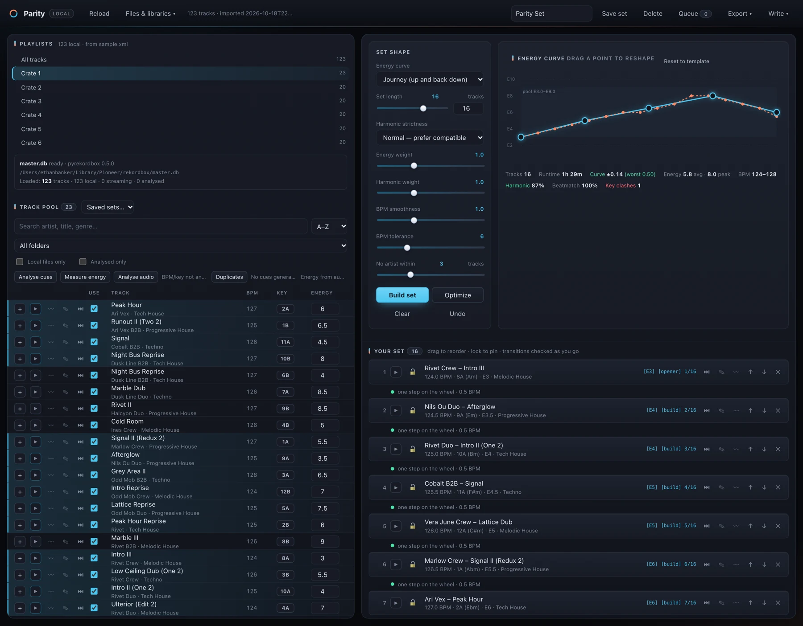
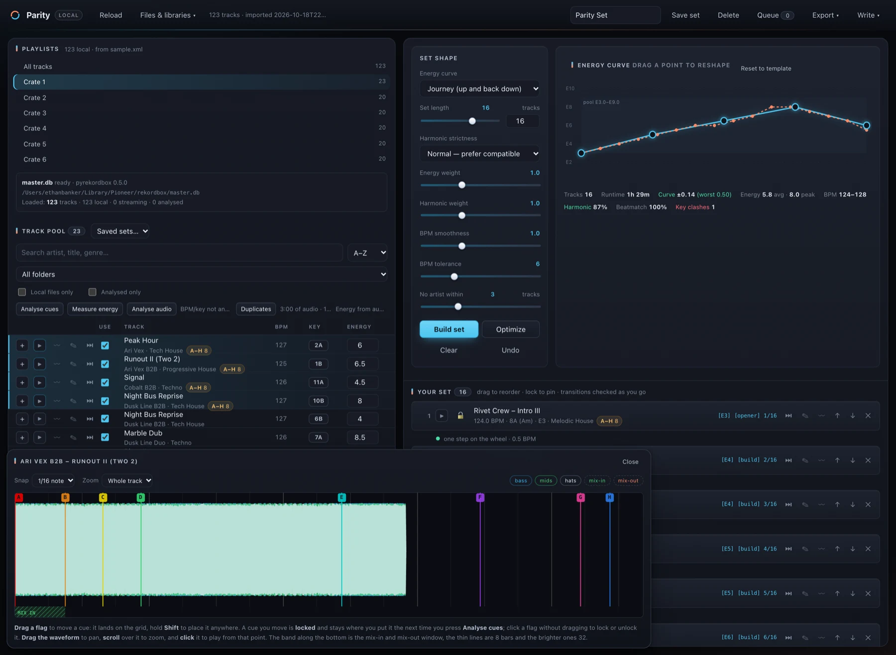
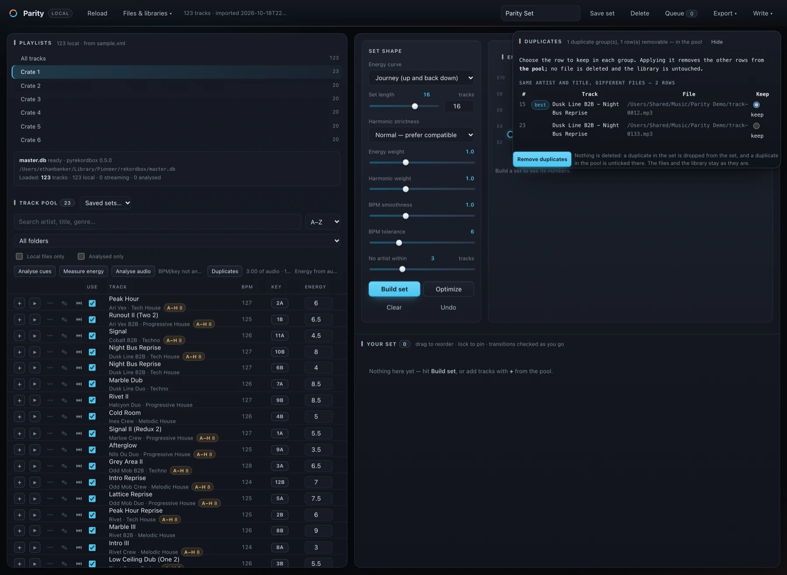
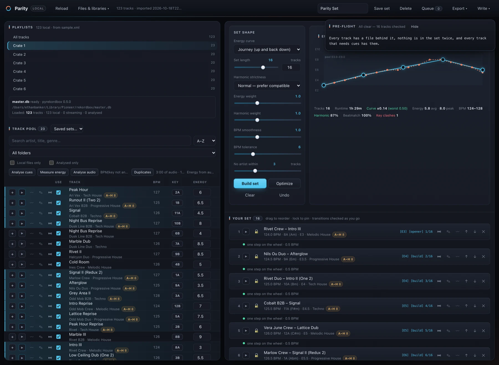

<p align="center">
  
</p>

<h1 align="center">Parity</h1>

<p align="center">
  <strong>Build harmonic DJ sets from your rekordbox library — locally.</strong><br>
  Energy curves, Camelot mixing, phrase-aware cues and one-click export, with no account and no cloud.
</p>

<p align="center">
  <a href="https://www.python.org/"></a>
  
  
  
</p>

<p align="center">
  
</p>

---

**Contents** · [Why Parity](#why-parity) · [Screenshots](#screenshots) · [Quick start](#quick-start) · [Build a set](#build-a-set) · [Cues](#cues-eight-pads-ah) · [Preview](#preview-and-listen) · [Library tools](#library-tools) · [Export](#export-and-write-back) · [How it works](#how-it-works) · [API](#api) · [Development](#development) · [Limitations](#limitations)

## Why Parity

- **It reads rekordbox, directly.** Parity opens `master.db` through a throwaway snapshot — playlists, folders, streaming flags and rekordbox's own ANLZ phrase analysis included. No XML export required.
- **It builds a set, not a list.** A dynamic program fits the whole set to your energy curve, then simulated annealing repairs key clashes, tempo jumps and artist repetition.
- **It explains itself.** Every build reports curve fit, worst deviation, harmonic percentage, beatmatch percentage and what the pool could not deliver.
- **Nothing leaves your machine.** Parity binds to `127.0.0.1`, makes no network requests, and never opens your live rekordbox database for writing without an explicit action and a backup.

The name is the idea: two tracks that are level with each other. The mark is a ring cut into two equal halves — cyan for the curve you asked for, coral for the set that came out.

## Screenshots

| Cue editor | Duplicate review |
| --- | --- |
|  |  |
| A three-band waveform, bar grid, mix-in/mix-out windows and draggable cues A–H. | Duplicates grouped across the set or pool; keep one row, delete no files. |

**Pre-flight** runs before any export and reports missing files, duplicate entries, streaming-only tracks and tracks with no cues — without blocking the export.



*Screenshots use a generated demo library. Track names are fictional.*

## Quick start

**Requirements:** Python 3.9+ (standard library only), macOS 13+ for the desktop app. `ffmpeg` is optional and enables previewing, waveform drawing, audio analysis, tag writing and format conversion. Reading `master.db` needs one optional Python package.

```bash
git clone https://github.com/ethanbanker/parity-dj.git parity
cd parity

# Recommended: read your live rekordbox library
python3 tools/install_extras.py
python3 parity.py
```

Parity opens at <http://127.0.0.1:8765> and loads `~/Library/Pioneer/rekordbox/master.db` on startup.

```bash
python3 parity.py                          # UI, reads master.db on startup
python3 parity.py --no-connect             # UI without reading the database
python3 parity.py --import ~/rekordbox.xml # start from an XML export
python3 parity.py --port 9000 --no-browser # different port, no browser tab
python3 parity.py --data-dir /somewhere    # where local data is kept
```

The XML fallback is always available: in rekordbox choose **File → Export Collection in xml format**, then drag the `.xml` onto the Parity window.

### macOS app

```bash
python3 tools/build_macos_app.py --install --run
```

This builds a native Cocoa app, copies it to `~/Applications`, and launches it. The app runs its own server as a child process, uses the next free port if 8765 is busy, and shuts the server down on quit. Its data lives in `~/Library/Application Support/Parity/`.

Building requires Apple's developer tools (`xcode-select --install`). The app is a snapshot of the code, so rebuild after changing Parity. Inside the app window, **Choose…** opens the native folder picker, and exports are written straight to `~/Downloads`.

### Command line

```bash
python3 parity.py --from-rekordbox                  # read master.db at startup
python3 parity.py --master-db /path/to/master.db    # non-standard database
python3 parity.py --write-status                    # can a write run now?
python3 parity.py --write-rekordbox "Friday Set"     # dry run of a saved set
python3 parity.py --write-rekordbox "Friday Set" --commit
python3 parity.py --write-rekordbox "Friday Set" --commit --tags
python3 parity.py --preflight "Friday Set"           # exit 1 if something is wrong
```

Write commands operate on saved sets in the local store, so point `--data-dir` at the folder the app uses when writing a set built in the window: `~/Library/Application Support/Parity`. A write is a dry run unless `--commit` is passed, and it refuses to run while the target app is open.

## Build a set

1. **Pick a playlist or folder** in the left pane. The pool shows BPM, Camelot key, energy, cue badges and per-row actions.
2. **Tick “Local files only”** to drop streaming stubs and missing paths. Parity reports what was removed and why.
3. **Choose a shape** — Journey, Peak time, Warm up, Festival, Cool down, Chill, Flat — or drag the curve's control points.
4. **Set the length and strictness**, then press **Build set**.
5. **Fine-tune**: drag rows to reorder, use `🔒` to pin a track, `✕` to drop it, and **Optimize** to re-run the solver around your changes. `Ctrl/Cmd+Z` undoes.
6. **Export or write back** when the set looks right.

The pool and set are virtualised, so multi-thousand-track playlists stay responsive. A set can hold up to 1000 tracks; a 300-track build from a 3000-track playlist takes a couple of seconds.

### The four things the builder optimises

| Goal | How Parity handles it |
| --- | --- |
| **Follow the curve** | Ranks targets and tracks, then uses a dynamic program to pick the group that minimises total squared distance. Matching the k-th quietest track to the k-th quietest target is optimal; the real question is *which* tracks to take. |
| **Mix in key** | Maps every track to the Camelot wheel and scores each transition: same key, relative major/minor, one step, diagonal lift, two-step lift, or clash. **Strict** refuses clashes and weak diagonal transitions, then repairs the weak points. |
| **Stay beatmatched** | Penalises BPM jumps beyond your tolerance and recognises half/double-time pairs such as 87 ↔ 174. |
| **Stay varied** | Penalises the same artist within N tracks. |

The chart shades the energy range your pool can actually reach, and warnings name the track or the range that stopped the build. A build that follows the curve and one that could not look different.

## Cues: eight pads, A–H

**Analyse cues** reads rekordbox's own phrase map (`Intro / Up / Down / Chorus / Outro`) and fills all eight hot-cue slots:

| Pad | Role | Lands on |
| --- | --- | --- |
| **A** | First downbeat | First beat of the first phrase |
| **B** | Intro end | Where the intro gives way to the body — the mix-in point |
| **C** | Build up | Last `Up` phrase before the drop |
| **D** | Main drop | First `Chorus` after the intro |
| **E** | Breakdown | First `Down`/`Bridge` after the drop |
| **F** | Drop 2 | Next `Chorus` after the breakdown |
| **G** | Outro | Where the outro starts |
| **H** | Mix-out | Closing 32, 16 or 8 beats |

Every slot is filled, every time. When a role has no matching phrase, the nearest in-order boundary is used and the cue records which rule produced it. A track rekordbox has not analysed falls back to a duration + BPM estimate, clearly marked **low confidence**.

Parity also places memory cues on the other phrase boundaries and removes rekordbox's `1.1Bars` memory cue when it would sit on top of hot cue A. Tracks that already have cues are marked `yours` or `rk`, and **Write ▾ → Already cued tracks** lets you replace them or keep them and skip those tracks.

### The cue editor

Every pool row and set row has a **〰** button. The editor draws:

- a **three-band waveform** — bass, mids and hats, each scaled against its own percentile;
- a **bar grid** from the track's BPM, with stronger lines every 32 bars;
- **mix windows** — green for the intro, orange for the closing bars;
- the **eight cues** in rekordbox's own pad colours.

Drag a flag to move it; it snaps to 1/16, beat or bar. Hold **Shift** to place it freely. A moved cue is locked, so the next **Analyse cues** keeps it where you put it. Click a flag without dragging to lock or unlock it by hand.

## Preview and listen

Every row has a **▶** button, and one shared player sits in the topbar. The player supports:

- **Space** play/pause, **[** / **]** previous/next hot cue, **Esc** stop;
- **↺ / ↻** ten-second jumps;
- **loop** with in/out points and `L` to toggle;
- **beat jump** by 1–32 beats using the track's own BPM (`,` and `.`);
- a **queue** — **⏭** on any row, and tracks advance automatically.

Playback streams byte ranges from the local file, so a long WAV starts immediately. Streaming-only rows are greyed out, and missing files say so by name.

## Library tools

**Analyse audio** measures BPM, key and a beat grid from the file with ffmpeg and numpy. It decodes the first two minutes, finds the strongest period in the onset autocorrelation, refines it against the beat grid with a least-squares line, and correlates chroma against the Krumhansl–Schmuckler profiles. Library values always win; measured values fill the gaps and are marked `audio`. Results are cached by path, size, mtime and model.

**Measure energy** reads loudness, brightness, dynamic range and drive from each file. This is the honest fix for a library where every untagged track lands on E4.2. A measured library can be narrow; the build says so in words instead of drawing a curve it did not follow.

**Duplicates** finds the same track listed twice, one file behind two rows, and the same artist and title on different files. It groups each problem once and recommends the best row to keep. Removing a duplicate drops it from the set or unticks it in the pool — it never deletes a file or a library row.

**Edit track metadata** with the ✎ button: title, artist, album, genre, comment, year, track number, BPM and key. Saving without the extra tick changes Parity's record only. Ticking **Write tags to the file** also rewrites the file's tags with ffmpeg, copying the audio rather than re-encoding it. WAV's INFO chunk cannot hold BPM or key, and the report names those fields instead of claiming a write that never landed.

**Watch folder & M3U** imports a playlist file or watches a folder for new audio. New files are probed with ffprobe, added to the library and appended to a playlist named for the folder. Existing paths are matched, so an import never creates a second row for the same file.

**Rename & convert** tidies a folder of downloads before rekordbox sees it: illegal characters, emoji, `[Official Video]`, `320kbps`, overlong names and Windows device names are handled; two files that tidy to the same name are numbered apart. Conversion writes AIFF or WAV, carries tags and artwork where the container supports them, reports measured leading silence, and never deletes the originals.

**Manage libraries** under **Files & libraries ▾** renames or deletes playlists in rekordbox and AUTO/PILOT, and removes the built set's tracks from either — every deletion begins as a dry run that you confirm, and the audio files stay on disk.

## Export and write-back

| Destination | What it produces |
| --- | --- |
| **AUTO/PILOT bundle** | A zip containing rekordbox XML, the set order/manifest, a printable set list and CSV |
| **Send to AUTO/PILOT** | The rekordbox XML written to `~/Downloads`, ready to import |
| **rekordbox XML** | A clean collection containing only the set, in order, with cues and tags |
| **Set package (.zip)** | XML + set list + cue log + pre-flight report + manifest |
| **M3U8 / CSV / TXT** | Playlist, spreadsheet or printable set list |
| **HTML / PDF** | A self-contained, print-friendly set list for a phone or a folder |
| **Write ▾ → rekordbox master.db** | Hot cues A–H and playlist order written straight into the database |

The XML export keeps real file URLs, injects `<POSITION_MARK>` cues with rekordbox's pad colours, writes a `<TEMPO>` beat grid, and can append a set tag to each comment: `[E7] [peak] 14/24` — energy, role, and position. Tags are appended, never assigned, so your own comment survives.

### Writing into rekordbox

**Quit rekordbox first.** Parity checks for the process, takes a timestamped backup next to `master.db`, then writes every cue row and the playlist reorder in one transaction. A dry run resolves the set against a snapshot copy and lists every row without touching the live file — and it works while rekordbox is open.

AUTO/PILOT's `.apd` sidecars are encrypted/obfuscated and have no public format. Parity writes the track rows and playlist order and reports how many tracks already have a sidecar; AUTO/PILOT creates the analysis when it imports or analyses the track.

## How it works

```
master.db ──┐
            ├──▶ rxdb.read_library ──▶ Library ──▶ poolfilter ──▶ builder ──▶ structure ──▶ exporting
.xml export ┘                          (read)      (purge)      (sequence)    (cues)       (files)
```

`POST /api/pipeline` runs the whole flow in one request. The UI walks the same stages with its own buttons, so there is no pipeline button to press.

The builder has four stages: **curve fit**, **selection repair** (swap in near-miss tracks when the fit chose something unsequenceable), **simulated annealing** over swaps, moves and swap-ins, and **strict repair** (walk every weak transition and try every local replacement, then swing a five-slot window across the set). Locks are held exactly. The cost function combines curve error, harmonic compatibility, tempo jumps and artist repetition; the constants were measured against real libraries, not chosen by taste.

A build is milliseconds over a few dozen tracks, which is why **Optimize** is worth pressing with different seeds.

## API

The server is a small JSON API on `127.0.0.1`. The UI uses it, and so can a script.

<details>
<summary><strong>Endpoint reference</strong></summary>

| Endpoint | Purpose |
| --- | --- |
| `GET /api/state` | Library metadata, playlists, saved sets, templates |
| `GET /api/tracks` | The pool for a playlist or the whole library |
| `POST /api/build` | Build a set from keys and a config |
| `POST /api/pool` | Preview a filter: kept count, removals and reasons |
| `POST /api/energy` | Set a track's energy override |
| `POST /api/optimize` | Re-optimise an existing order, keeping locks |
| `POST /api/preflight` | Missing files, duplicate entries, missing cues |
| `POST /api/tags` | The `[E7] [peak] 14/24` tag plan for an order |
| `GET /api/rekordbox` | Database path, extra availability, library counts |
| `POST /api/rekordbox/connect` | Read `master.db`, with XML fallback |
| `GET /api/audio` | Stream a local track with byte-range support |
| `GET /api/waveform` | Three-band waveform peaks, cached by file |
| `POST /api/cues` | Analyse phrases and store hot + memory cues |
| `GET /api/cues` | One track's cue plan, grid and lock state |
| `POST /api/cues/edit` | Move or lock a cue |
| `POST /api/energy/audio` | Measure energy from audio |
| `POST /api/energy/audio/clear` | Forget the measured energies |
| `POST /api/analyze` | Measure BPM, key and beat grid |
| `POST /api/analyze/clear` | Forget the measured tempo, keys and grids |
| `POST /api/cues/clear` | Forget the stored cue plans |
| `POST /api/duplicates` | Group duplicates in a set or pool |
| `POST /api/duplicates/remove` | Remove the unchosen rows |
| `POST /api/track/edit` | Edit metadata, optionally write file tags |
| `GET/POST /api/watch` | Watch-folder settings and an immediate save/scan |
| `POST /api/watch/tick` | Scan the watch folder once, now |
| `POST /api/import/m3u` | Import an M3U/M3U8 as a playlist |
| `POST /api/ingest` | Scan a download folder; report names and conversions |
| `POST /api/ingest/run` | Convert and copy that folder |
| `POST /api/cue-policy` | What to do with tracks that already have cues |
| `POST /api/export` | Write an export in any format |
| `POST /api/import` | Import an XML library |
| `GET/POST /api/sets` | List, load or save sets |
| `POST /api/sets/delete` | Delete a saved set |
| `POST /api/reload` | Re-read the stored library |
| `POST /api/pipeline` | Filter, sequence, cue, export and save in one call |
| `GET /api/write/status` | Whether rekordbox / AUTO/PILOT can be written to now |
| `POST /api/write/rekordbox` | Write cues and playlist order into `master.db` |
| `POST /api/write/autopilot` | Write tracks and playlist order into AUTO/PILOT |

</details>

## Project layout

```
parity.py                 entry point: starts the local server
parity/
  camelot.py              key notation and harmonic scoring
  rekordbox.py            collection XML and playlist parser
  rxdb.py                 master.db reader (snapshot copy, never live)
  writedb.py              master.db writer: cues, playlists, backups
  autopilot.py            AUTO/PILOT library writer
  poolfilter.py           playlist/folder selection and purge rules
  builder.py              curve templates, construction, optimisation
  structure.py            ANLZ phrases, beat grids, cue placement
  energy.py               metadata energy heuristics
  audio.py                energy measured from audio
  analysis.py             BPM, key and beat grid from audio
  duplicates.py           duplicate grouping and removal plans
  metadata.py             validation and ffmpeg tag writing
  watchfolder.py          M3U import and folder scanner
  ingest.py               filename tidying and conversion
  waveform.py             three-band waveform peaks
  tags.py                 set tags and comment merging
  preflight.py            missing-file and duplicate checks
  pdf.py                  dependency-free PDF writer
  exporting.py            XML, bundles, packages, CSV, TXT, HTML, PDF
  server.py               JSON API and static file server
  web/                    the UI (HTML/CSS/JS, no build step)
tools/
  install_extras.py       optional pyrekordbox / numpy
  build_macos_app.py      builds Parity.app
  macos/main.swift        native window, menu bar and server lifecycle
  make_icon.py            draws and packs the app icon
  make_sample_library.py  generates a synthetic rekordbox XML
tests/                    unittest suite and fixtures
docs/                     screenshots and icon
```

Your data lives in `data/` (or `--data-dir`): `store.json` for edits, cue plans and saved sets, plus a copy of the imported library. `build/` and `dist/` are generated and ignored.

## Development

```bash
python3 -m unittest discover -s tests -t .
```

The suite covers 612 tests: key notation, the XML parser, energy heuristics, curve adherence, locks, the optimiser, every export format, HTML/PDF pagination and escaping, duplicate grouping, metadata validation and tag writing, tempo/key/grid estimation, M3U and watch-folder behaviour, the `master.db` reader and writer (through duck-typed stand-ins where pyrekordbox is absent), the API, a 1500-track round trip, and an HTTP smoke test of the real server.

Two tests are skipped when `librosa` is not installed; the numpy path is tested independently.

Optional extras:

```bash
python3 tools/install_extras.py --check    # report what is available
python3 tools/install_extras.py            # install for the current user
python3 tools/install_extras.py --venv DIR # isolated virtualenv
```

## Limitations

- **Energy is an estimate until measured.** Tags, ratings, genres and BPM are guesses; **Measure energy** reads the file. Cue placement uses rekordbox's analysis for tracks that have it, and a clearly marked low-confidence duration + BPM estimate for tracks that do not.
- **The `keep` policy identifies cues by name.** A hand-placed cue named `Main Drop` can look like Parity's own. Avoid rekordbox's eight role names if you rename cues yourself.
- **One tempo per track.** Analysis measures a single BPM and grid; it does not split tempo changes, and it does not write BPM back into `master.db`.
- **File tag writing needs ffmpeg and follows the container.** WAV cannot hold BPM, key or artwork; Parity names the fields it could not write.
- **Duplicates are never deleted from disk.** A duplicate leaves the set or is unticked in the pool. Library-wide deletion is a separate, explicit action under **Manage libraries**.
- **The watch folder imports into Parity, not rekordbox.** Export or write the set when you want the tracks in a DJ app.
- **The queue and loop are listening tools.** They are not saved with a set and do not travel in an export.
- **HTML/PDF set lists are text.** No waveform or artwork. The PDF's base-14 fonts replace non-Latin-1 characters with `?`; the HTML keeps them.
- **The cue editor waveform needs ffmpeg and a local file.** Tracks longer than 30 minutes are drawn as their first 30 minutes. Streaming-only tracks have no waveform, though their cues are still shown.
- **Streaming names may be encrypted.** For Spotify and Beatport rows, rekordbox stores the title encrypted (`$A7:v1:…`) and provides no local key. Parity shows the service and track id, keeps readable fields such as BPM and length, and marks the row `streaming`.
- **AUTO/PILOT sidecars are not written.** Track rows and playlist order are; analysis appears when AUTO/PILOT processes the track.
- **The Mac app is a snapshot.** Rebuild it after changing the code; it is compiled for the architecture it was built on.
- **The server has no password.** It binds `127.0.0.1` by default. If you use `--host` to expose it, every API action is available to anyone who can reach the port.
- **`master.db` is read-only until you ask for a write.** Reading uses a temporary copy. Writing requires an explicit action, a closed rekordbox and a backup.

## License

MIT — see [LICENSE](LICENSE).
